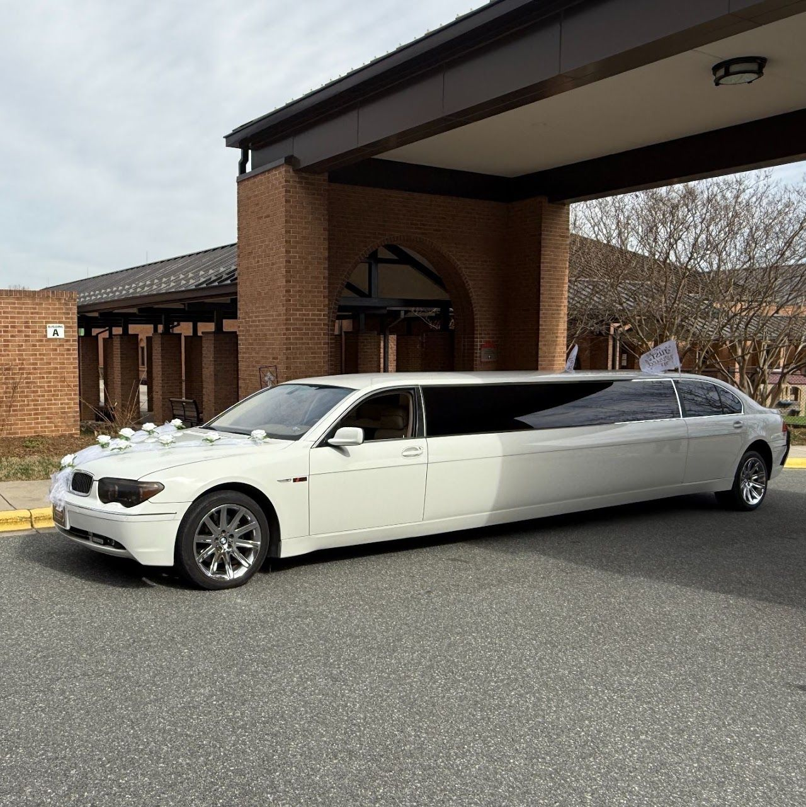

Files starting with an underscore (like this one) are never published.
To write a post: copy this file, rename it (e.g. 2026-12-01-my-new-post.md),
fill in the details above, change `draft: true` to `draft: false`, and run:

    python3 tools/build_blog.py

## This is a section heading

Regular paragraphs are just text. Leave a blank line between paragraphs.

You can make text **bold** or *italic*, and add [a link](/contact/#quote).

### A smaller heading

- Bullet point one
- Bullet point two

1. Numbered step one
2. Numbered step two

> A pull quote stands out in large italic text.

---

Photos: put them in assets/img/ and refer to them as /assets/img/your-photo.jpg.
Links to other pages look like /fleet/, /services/, /tours/, /contact/#quote or /blog/some-post/.
